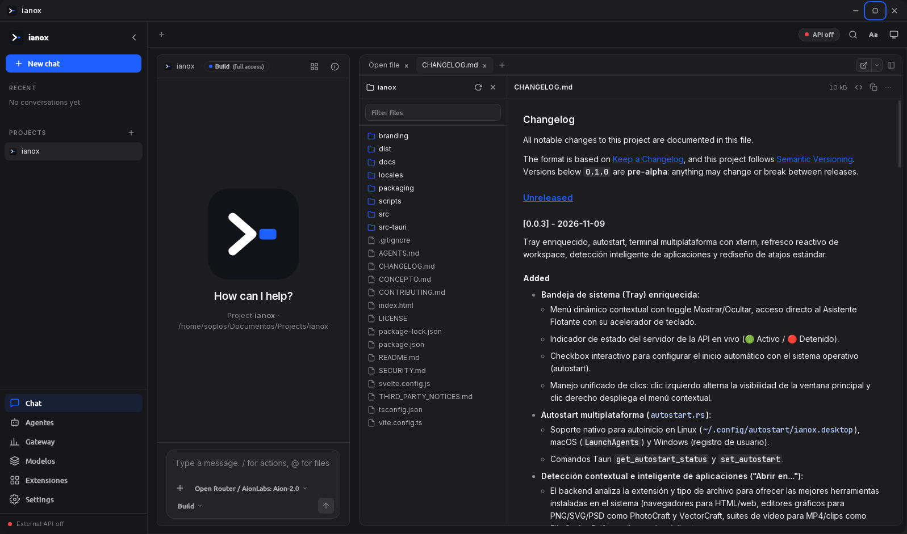

# ianox


Local AI gateway, model manager and coding agent for the desktop.



It gives you one place to route requests across providers, manage local and remote models, curate routes with fallbacks, expose an OpenAI / Anthropic / Ollama compatible server, and work with an agent that has a terminal, files and tools — all on your machine, no telemetry, no cloud required.

## Architecture

ianox is a Tauri 2 application: a Rust backend and a Svelte 5 + Vite frontend, rendered through the system webview.

- **Backend** (`src-tauri/src/`): one module per concern — `config.rs` (typed configuration and shared state), `provider.rs` (provider kinds and HTTP payload shapes), `router.rs` (internal routing, glob matching, SSE streaming), `server.rs` (the Axum HTTP gateway), `agent.rs` (agent loop bookkeeping), `tools.rs` (tool registry with JSON schemas), `mcp.rs` (MCP server launch and probing), `sessions.rs` (chat history on disk), `terminal.rs` (PTY sessions via `portable-pty`), `usage.rs` + `pricing.rs` (token accounting and model pricing), `extensions.rs` (skills, plugins, LSP), `i18n.rs`, and `tray.rs` + `window.rs` (tray icon, custom title bar, window state). Tauri commands are registered in `main.rs` and implemented in `commands.rs`.
- **Frontend** (`src/`): one Svelte view per section in `src/pages/`, shared components in `src/components/` (sidebar, top bar, context panel, terminal, file explorer, review panel, browser panel, charts, modals) and the reactive app store in `src/app.svelte.ts`.
- **Internal vs. external routing**: the UI never goes through HTTP. `router.rs` resolves the provider and streams straight to the window; the Axum server exists only for external clients (IDEs, CLIs, `curl`).
- **Streaming**: provider chunks are forwarded as SSE and emitted to the frontend as events, so long answers never block the interface. Chat streams can be cancelled at any time.
- **Persistence**: configuration, sessions and usage counters are stored as JSON in the user's config directory. Pricing defaults ship in `src-tauri/pricing.default.json` and are copied out on first run.
- **Single instance**: a second launch focuses the running window instead of starting a new process; the tray icon keeps the gateway reachable.

## Sections

- **Dashboard**: gateway status, provider and route summary, usage charts and quick actions.
- **Chat**: streaming conversation with any configured model, markdown rendering, per-session token and cost accounting, cancel at any time, and side panels for terminal, file explorer, git review and browser.
- **Agents**: configurable agents (`build` / `plan` modes) with their own model and system prompt — `build` has write access, `plan` is read-only.
- **Gateway**: the embedded HTTP server (default `127.0.0.1:20128`) with start / stop, CORS, optional bearer token and live status.
- **Models**: model catalogue merged from every enabled provider plus local Ollama models, with pull and delete actions.
- **Providers**: OpenAI, Anthropic, OpenRouter, Ollama, Google, Azure and custom OpenAI-compatible endpoints, each with base URL, API key, model list, priority, rate limits and a connection test.
- **Routes**: glob-based model patterns mapped to ordered provider chains, with weighted routing and automatic fallback when a provider fails, is disabled or returns a rate limit.
- **MCP**: Model Context Protocol servers launched from the app, with argument / environment editing and a probe that verifies the process answers.
- **Extensions**: skills, plugins and LSP server detection for the active project.
- **Settings**: theme, language, server defaults and configuration management.

## API

The gateway speaks three protocols on the same port:

| Endpoint | Protocol | Status |
|---|---|---|
| `GET /health` | Status | Implemented |
| `GET /v1/models` | OpenAI | Implemented |
| `POST /v1/chat/completions` | OpenAI (streaming and non-streaming) | Implemented |
| `POST /v1/messages` | Anthropic | Implemented |
| `GET /api/tags` | Ollama | Implemented |
| `POST /api/chat` · `/api/generate` | Ollama | Implemented |
| `POST /v1/completions` · `/v1/embeddings` | OpenAI | Declared, returns `501` |
| `POST /api/show` · `/api/pull` · `/api/delete` | Ollama | Declared, returns `501` |

Point any client at `http://127.0.0.1:20128` and request the model names you defined in your providers and routes. If an auth token is configured, send it as `Authorization: Bearer <token>`.

## Agent tools

The agent loop advertises tools with JSON schemas and executes them on the model's behalf: `read`, `glob`, `grep`, `write`, `edit` and `shell`. Read-only tools always run; write and shell calls are the ones that change your workspace, so `plan` agents never receive them.

## Keyboard shortcuts

| Shortcut | Action |
|---|---|
| Ctrl + ` | Open or close the side panel |
| Ctrl + W | Close the active tab |
| Ctrl + Shift + T | Reopen the last closed tab |
| Ctrl + Alt + T | New terminal |
| Ctrl + Alt + P | Open file |
| Ctrl + Alt + R | Review (git changes) |
| Ctrl + Alt + B | Open browser |

Shortcuts are defined once in `src/shortcuts.ts` and rendered from there.

## Languages

The interface is available in English and Español. It starts in the system language and falls back to English. Translations live in `locales/*.po`; the JSON dictionaries consumed by the UI are generated from them.

```bash
npm run i18n          # regenerate src/locales/*.json from locales/*.po
npm run i18n:check    # fail if any key is missing
```

## Building

Requirements: Node.js 18+, Rust 1.77+, and the usual Tauri system dependencies (WebKitGTK and GTK 3 on Linux).

```bash
npm install
npm run dev:app         # development (Tauri + Vite)
npm run build:app       # release bundle
npm run check           # type-check the frontend
```

Other useful scripts:

```bash
npm run dev             # frontend only, in the browser
npm run build           # type-check + production frontend build
npm run icons           # regenerate the icon set from src-tauri/icons/source.png
npm run flatpak:build   # build the Flatpak bundle
npm run flatpak:run     # run the Flatpak build
npm run flatpak:install # install the Flatpak build
```

## Branding

The icon is a four-point spark in electric blue `#1E5FFF` over a graphite squircle tile (`#26262E → #141418`). Masters live in `branding/` (`ianox-icon.svg`, `.psd`, `.png`) and the applied set in `src-tauri/icons/`. The accent colour is the only blue in the interface; the rest is graphite neutrals plus semantic greens, ambers and reds.

## License

Copyright © 2026 Soplos. Published under the MIT license (see the `license` field in `src-tauri/Cargo.toml`).
